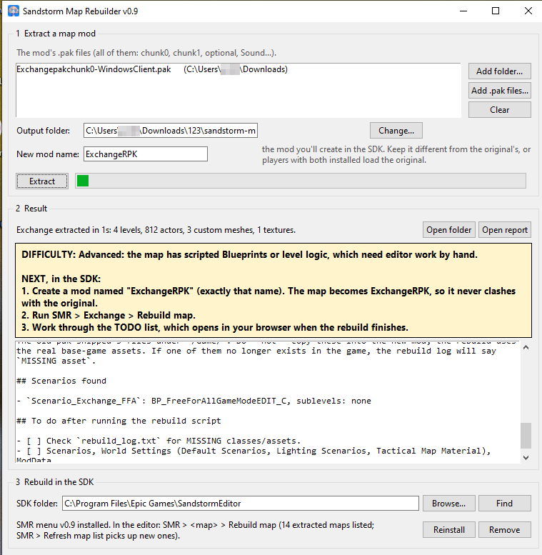
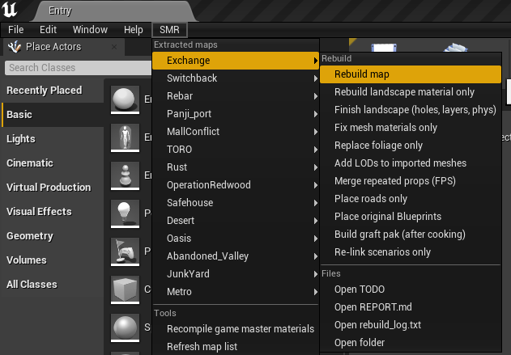
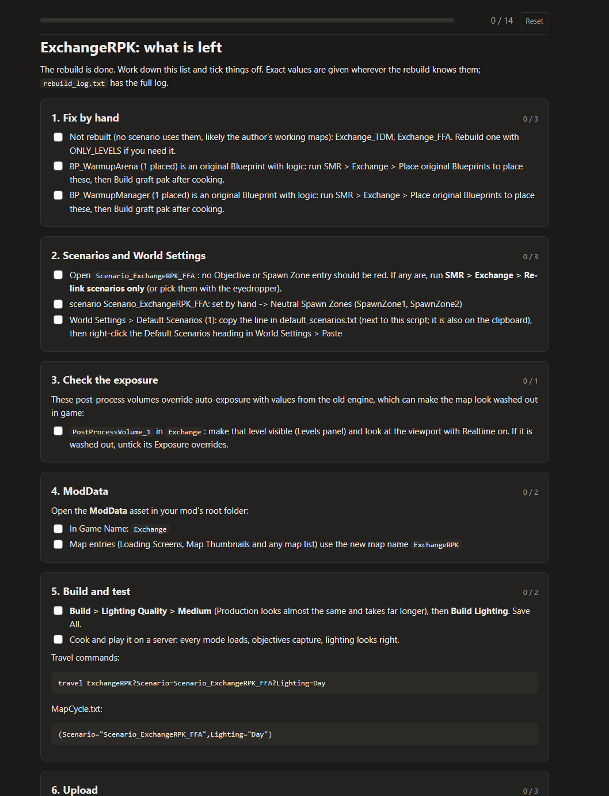

<div align="center">

# Sandstorm Map Rebuilder

Rebuilds cooked Insurgency: Sandstorm map mods as editable maps in the current SDK.

[](../../releases/latest)
[](../../releases)

[Download](../../releases/latest) · [User guide](docs/GUIDE.md) · [Quick start](#quick-start) · [Workflow](#workflow) · [Menu reference](#menu-reference) · [Limitations](#limitations) · [License](#license)

</div>

## Overview

Map mods break when the game or SDK updates, and most authors never release their source files. Sandstorm Map Rebuilder reads a mod's `.pak` files from mod.io, extracts the levels and the mod's own assets, and rebuilds the map inside the Sandstorm SDK so it can be fixed, cooked and uploaded again.

It has been used to rebuild Rust, Shipment, Shoot House, JunkYard and TORO.

### What it handles

- Levels and sublevels, with streaming, lighting scenarios, post process, fog and sky
- The mod's static meshes (exported to FBX with UVs, normals, vertex colors, material slots, collision and lightmap settings), textures and materials
- Custom materials as stand-ins, with roughness and metallic values read from the compiled shaders
- Landscape heightmaps and paint layers, with a rebuilt layered landscape material and grass types
- Foliage, landscape spline meshes, volumes, spawns, restricted and playable areas, collision overrides
- Scenarios, objectives and World Settings
- Settings-only Blueprints (game modes, characters) and jump pads
- Assets the mod placed under `/Game/` or borrowed from other mods, relocated into the rebuilt mod

What it can't do automatically (landscape import, lighting builds, ModData and a few others) is written to a `TODO.md` checklist for each map, with exact values.

## Quick start

This is the short version. The [user guide](docs/GUIDE.md) covers every step in detail, with settings, examples and a troubleshooting table.

1. Download `SandstormMapRebuilder-vX.zip` from [Releases](../../releases/latest), unzip it and run `SandstormMapRebuilder.exe`. Python is not required. The executable is not code-signed, so Windows SmartScreen shows an "unknown publisher" warning the first time (More info > Run anyway); running from source is the alternative, see [Development](#development).
2. Click **Add folder...**, select the folder containing the mod's `.pak` files and click **Extract**. Subscribed mods are in `C:\Users\Public\mod.io\254\mods\<mod id>\`. Include every pak of the mod (chunk0, chunk1, optional, Sound).

   The app then shows how much editor work the map needs (Easy, Landscape or Advanced) and anything to check before rebuilding. The same list is at the top of `REPORT.md`.

   

3. In the SDK section, click **Find**, then **Install SMR menu**, and restart the SDK.
4. In the SDK, create a mod with the name the app shows, then run **SMR > *map* > Rebuild map**.

   

5. Work through the TODO list (`TODO.html`, also saved as `TODO.md`), which opens in your browser when the rebuild finishes.

   

> [!IMPORTANT]
> The editor runs the copy of the rebuild script installed with the menu. After updating the app, click **Update SMR menu** and restart the SDK.

## Workflow


Each step is covered in the [user guide](docs/GUIDE.md).

1. **Rebuild map.** Places textures, materials, meshes, settings-only Blueprints, and every level with its actors.
2. **Landscape import.** `TODO.md` lists the import settings (location, scale, section size, component count) and the heightmap and layer files. Then run **Finish landscape (holes, layers, phys)**. Run **Rebuild landscape material only** if the layers need to be redone.
3. **Optional passes:** Replace foliage only, Place roads only, Add LODs to imported meshes, Merge repeated props.
4. **Scenarios.** Run **Re-link scenarios only**, then paste the contents of `default_scenarios.txt` (also copied to the clipboard) into *World Settings > Default Scenarios*. A mod with several maps gets one `default_scenarios_<map>.txt` per map; paste each into that map's World Settings. This field can't be set from Python.
5. **Original Blueprints**, if the map has scripted actors. See [Original Blueprints](#original-blueprints).
6. **Lighting.** Build each lighting scenario separately: hide the other scenario level, run **Build > Build Lighting Only**, and answer **Yes**, not *Yes All*, when asked about hidden levels. Medium quality is considerably faster than Production with little visible difference.
7. **Build > Build Paths.** Repeat after merging props, placing roads or changing collision.
8. **ModData**, then cook the mod.
9. **Build graft pak**, if step 5 was used. Repeat after every cook, since cooking rewrites the paks folder.
10. **Upload**, then test on a server. See [Testing and uploading](#testing-and-uploading).

## Menu reference

| Entry | Description |
|---|---|
| Rebuild map | Textures, materials, meshes, Blueprints, then every level and its actors |
| Rebuild landscape material only | The layered landscape material and its grass types |
| Finish landscape (holes, layers, phys) | Run after importing a landscape by hand: cuts the original's holes, assigns each paint layer its Layer Info and sets the phys material |
| Fix mesh materials only | Points every imported mesh back at its original materials, for meshes showing the gray grid material, and repairs stand-in materials that render plain grey. Leaves the levels alone. |
| Replace foliage only | Places foliage as instanced meshes. Requires an Actor Blueprint named `BP_SMR_Instances` with a Hierarchical Instanced Static Mesh component, in any folder; it is copied into the mod. |
| Place roads only | Roads, curbs and fences that were landscape splines |
| Add LODs to imported meshes | Generates LODs for the mod's own meshes, which are extracted at full detail only |
| Merge repeated props (FPS) | Combines meshes placed three or more times into one instanced component per level. Mirrored copies, and meshes whose materials can't be drawn instanced in a cooked game, are left separate. |
| Place original Blueprints | Creates placeholders for the original's scripted Blueprints and places their actors |
| Build graft pak (after cooking) | Packs the original compiled Blueprints, and the files they use, next to the cooked paks |
| Re-link scenarios only | Points scenarios and World Settings at the current objectives and spawn zones |
| Open TODO, REPORT.md, rebuild_log.txt, folder | The remaining steps and the extracted files |
| Recompile game master materials | Fixes game materials stuck on the default gray texture |
| Refresh map list | Lists maps extracted since the editor started |

Every entry can be run again. It removes what it placed on the previous run and leaves existing assets alone.

## Original Blueprints

Blueprint graphs can't be rebuilt from cooked files, and the UE 4.27 editor has no Python API for creating graph nodes. When the original mod's scripted Blueprints use the same paths as the rebuilt mod, their original compiled files can be shipped instead. This is referred to as the graft. When the mod is renamed, the paths inside those files are rewritten to the new name as the graft pak is built.

The extractor keeps the original files these Blueprints need. Run **Place original Blueprints**, fix the placeholders listed in `TODO.md`, and after cooking run **Build graft pak**. The [user guide](docs/GUIDE.md#8-original-blueprints) explains how to fix each placeholder.

The graft ships the original author's compiled work unchanged, so credit them.

## Testing and uploading

> [!WARNING]
> mod.io processes each upload before it becomes available; a clock icon is shown on the Files page until it finishes. A server then downloads the update in the background: the log shows `ModEvent: BeginInstall`, then `Installed`, and the map is mounted at that point without a restart. Restarting before `Installed` discards the download.

- Download progress on a Linux server: `du -sh <server>/mod.io/common/254/mods/<mod id>`
- *"An upload session with that idempotency key has already been completed"*: mod.io considers the upload identical to an earlier one. Cook again, rebuild the graft pak if used, and upload.
- mod.io dedicated servers load mods from the server account's subscriptions, not `Mods.txt`. Hidden mods are only visible to their team; if the server account isn't the uploader, add it as a team member.
- More symptoms and fixes are in the [troubleshooting table](docs/GUIDE.md#troubleshooting).
- Travel command: `AdminTravelMap <Map>?Scenario=<Scenario>`. `TODO.md` lists the scenarios.

## Limitations

- Skeletal meshes and animations are not extracted. Animated actors can only be restored with the graft.
- Particle systems (Cascade and Niagara) and Procedural Foliage Spawners are not rebuilt. Particle actors are listed in `TODO.md` with their positions; spawner output is already in the placed foliage, so the map is complete without the spawner itself.
- All of the mod's paks are needed. The report lists assets the levels use that are in none of the paks given; chunk numbers with gaps (chunk0, chunk1, chunk10) are normal and do not by themselves mean a pak is missing.
- Blueprint logic is not rebuilt. Without the graft, scripted actors are listed in `TODO.md` with their positions. A sublevel whose level Blueprint has logic is shipped as the original level by the graft; a persistent level's level Blueprint has to be rebuilt by hand.
- The TacticalGrid is not placed, because a partial grid caused the game to hang when bots spawned. Bots work without one.
- The landscape import and lighting builds are manual.
- Performance matches the original. If a map runs poorly, check the directional light's *Dynamic Shadow Distance* and cascade count first, then try Merge repeated props and LODs.
- Supported paks: UE4 pak v8 to v11 (UE 4.22 and later), unencrypted, uncompressed or zlib. This covers Sandstorm mods from 2020 onward; static meshes are read in the UE 4.22, 4.24 and 4.25+ layouts.

### Notes

- Landscape grass requires **Build > Build Grass Maps** and Foliage scalability above Low.
- The landscape import panel takes the center location; the actor's Details panel shows the corner. The report gives both.
- The editor shows both lighting scenarios at once, which doubles the suns and sky lights and inflates shadow cost. Only one loads in game. Hide one scenario level when checking lighting or performance.
- "Unable to Check Out From Source Control" messages on save are harmless. Disable source control in the editor toolbar to stop them.

## Credits and etiquette

Credit the original author in the upload, along with the authors of any mods it depends on. If the author is still active, ask before republishing. The rebuild gets its own mod name (the original's plus `RPK` by default), so it can be installed next to the original; tell server owners the new map name for their map cycles. To add a scenario to a map that still works, consider a scenario-only mod that lists the original as a dependency.

## Development

```
app/gui.py            desktop app (tkinter)
extract_map.py        command-line extraction: python extract_map.py <paks or folder> [-o OUT]
smr/core.py           extraction entry point, map list, SDK detection, menu install
smr/extract.py        level, landscape, foliage, spline, scenario and material extraction
smr/pak.py            UE4 pak reader (v8 to v11)
smr/uasset.py         cooked uasset/umap parser
smr/staticmesh.py     cooked StaticMesh reader (UE 4.22 / 4.24 / 4.25+ layouts) and FBX writer
smr/gloss.py          roughness from compiled DXBC shaders
smr/preflight.py      checks run on a fresh extract (difficulty, scenario and lighting problems, missing assets)
sdk/rebuild_map.py    runs inside the SDK; installed as smr_rebuild_map.py
sdk/smr_menu.py       SDK editor menu; MENU_VERSION must match smr/__init__.py
sdk/smr_localize_deps.py, sdk/smr_rename_mod.py   one-off SDK scripts, shipped in the release's extras/ (see the guide)
```

Run from source with `pip install -r requirements.txt` and `python app/gui.py`.

To release, bump `__version__` in `smr/__init__.py` and `MENU_VERSION` in `sdk/smr_menu.py`, commit, and push a matching tag (`git tag v0.9 && git push origin v0.9`). GitHub Actions builds the executable and publishes the zip to Releases. A `DISCORD_WEBHOOK` repository secret enables a Discord announcement.

## License

[PolyForm Noncommercial 1.0.0](LICENSE.md): free to use, change and share for any noncommercial purpose. Selling the tool, or a service built on it, is not permitted.

---

<sub>Not affiliated with New World Interactive or Focus Entertainment.</sub>
