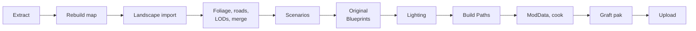

<div align="center">


# Sandstorm Map Rebuilder

Rebuilds cooked Insurgency: Sandstorm map mods as editable maps in the current SDK.

[](../../releases/latest)
[](../../releases)

[Download](../../releases/latest) · [Quick start](#quick-start) · [Workflow](#workflow) · [Menu reference](#menu-reference) · [Limitations](#limitations)

</div>

## Overview

Map mods break when the game or SDK updates, and most authors never release their source files. Sandstorm Map Rebuilder reads a mod's `.pak` files from mod.io, extracts the levels and the mod's own assets, and rebuilds the map inside the Sandstorm SDK so it can be fixed, cooked and uploaded again.

It has been used to rebuild Rust, Shipment, Shoot House, JunkYard and TORO.

<div align="center">

<br><sub>TORO: original (left), rebuilt (right)</sub>
</div>

| Map | | | | |
|:---:|:---:|:---:|:---:|:---:|
| <br>TORO | <br>Rust | <br>Shipment | <br>Shoot House | <br>JunkYard |

### What it handles

- Levels and sublevels, with streaming, lighting scenarios, post process, fog and sky
- The mod's static meshes (exported to FBX with UVs, normals, vertex colours, material slots, collision and lightmap settings), textures and materials
- Custom materials as stand-ins, with roughness and metallic values read from the compiled shaders
- Landscape heightmaps and paint layers, with a rebuilt layered landscape material and grass types
- Foliage, landscape spline meshes, volumes, spawns, restricted and playable areas, collision overrides
- Scenarios, objectives and World Settings
- Settings-only Blueprints (game modes, characters) and jump pads
- Assets the mod placed under `/Game/` or borrowed from other mods, relocated into the rebuilt mod

What it can't do automatically (landscape import, lighting builds, ModData and a few others) is written to a `TODO.md` checklist for each map, with exact values.

## Quick start

1. Download `SandstormMapRebuilder-vX.zip` from [Releases](../../releases/latest), unzip it and run `SandstormMapRebuilder.exe`. Python is not required.
2. Click **Add folder...**, select the folder containing the mod's `.pak` files and click **Extract**. Subscribed mods are in `C:\Users\Public\mod.io\254\mods\<mod id>\`. Include every pak of the mod (chunk0, chunk1, optional, Sound).

   

3. In the SDK section, click **Find**, then **Install SMR menu**, and restart the SDK.
4. In the SDK, create a mod with the name the app shows, then run **SMR > *map* > Rebuild map**.

   

5. Work through `TODO.md`, which opens when the rebuild finishes.

   

> [!IMPORTANT]
> The editor runs the copy of the rebuild script installed with the menu. After updating the app, click **Update SMR menu** and restart the SDK.

## Workflow



1. **Rebuild map.** Places textures, materials, meshes, settings-only Blueprints, and every level with its actors.
2. **Landscape import.** `TODO.md` lists the import settings (location, scale, section size, component count) and the heightmap and layer files. Run **Rebuild landscape material only** if the layers need to be redone.
3. **Optional passes:** Replace foliage only, Place roads only, Add LODs to imported meshes, Merge repeated props.
4. **Scenarios.** Run **Re-link scenarios only**, then paste the contents of `default_scenarios.txt` (also copied to the clipboard) into *World Settings > Default Scenarios*. This field can't be set from Python.
5. **Original Blueprints**, if the map has scripted actors. See [Original Blueprints](#original-blueprints).
6. **Lighting.** Build each lighting scenario separately: hide the other scenario level, run **Build > Build Lighting Only**, and answer **Yes**, not *Yes All*, when asked about hidden levels. Medium quality is considerably faster than Production with little visible difference.
7. **Build > Build Paths.** Repeat after merging props, placing roads or changing collision.
8. **ModData**, then cook the mod.
9. **Build graft pak**, if step 5 was used. Repeat after every cook, since cooking rewrites the paks folder.
10. **Upload**, then test on a server. See [Testing and uploading](#testing-and-uploading).

## Menu reference


| Entry | Description |
|---|---|
| Rebuild map | Textures, materials, meshes, Blueprints, then every level and its actors |
| Rebuild landscape material only | The layered landscape material and its grass types |
| Replace foliage only | Places foliage as instanced meshes. Requires an Actor Blueprint named `BP_SMR_Instances` with a Hierarchical Instanced Static Mesh component, in any folder; it is copied into the mod. |
| Place roads only | Roads, kerbs and fences that were landscape splines |
| Add LODs to imported meshes | Generates LODs for the mod's own meshes, which are extracted at full detail only |
| Merge repeated props (FPS) | Combines meshes placed three or more times into one instanced component per level. Mirrored copies, and meshes whose materials can't be drawn instanced in a cooked game, are left separate. |
| Place original Blueprints | Creates placeholders for the original's scripted Blueprints and places their actors |
| Build graft pak (after cooking) | Packs the original compiled Blueprints next to the cooked paks |
| Re-link scenarios only | Points scenarios and World Settings at the current objectives and spawn zones |
| Open TODO.md, REPORT.md, rebuild_log.txt, folder | The remaining steps and the extracted files |
| Recompile game master materials | Fixes game materials stuck on the default grey texture |
| Refresh map list | Lists maps extracted since the editor started |

Every entry can be run again. It removes what it placed on the previous run and leaves existing assets alone.

## Original Blueprints

Blueprint graphs can't be rebuilt from cooked files, and the UE 4.27 editor has no Python API for creating graph nodes. When the original mod's scripted Blueprints use the same paths as the rebuilt mod, their original compiled files can be shipped instead. This is referred to as the graft.


1. **Export the original files with [FModel](https://fmodel.app).** Set *Archive Directory* to the folder with the mod's paks, *UE Versions* to `GAME_UE4_27` and *Loading Mode* to *All*. Right-click the mod's `Blueprints` folder and choose **Export Folder > Raw Data**, and do the same for any folder those Blueprints use (meshes, animations). Keep the default output folder (`Downloads\Fmodel\Output`), or copy the exported `Content` folder to `SMR\<map>\graft`.
2. **Run Place original Blueprints.** It creates an empty placeholder at each original path and places the actors in a `Graft` folder.
3. **Fix the placeholders** as listed in `TODO.md`, then compile and save each one.
   - Each placeholder needs the original's root component name and type. Add the component and drag it onto `DefaultSceneRoot`, which can't be renamed.
   - Add the Instance Editable variables listed. They carry per-actor settings such as which button opens which door.
   - Leave the graphs empty. The original classes replace the placeholders at runtime.
4. **Run Place original Blueprints again.** Only the graft pak step should remain.
5. **After cooking, run Build graft pak.** It writes `<Mod>pakchunk1-WindowsClient_P.pak` next to the cooked paks. Assets the original still references at an older path (for example, a skeleton its author moved) are also packed at that path.

The graft ships the original author's compiled work unchanged, so credit them.

## Testing and uploading

> [!WARNING]
> mod.io processes each upload before it becomes available; a clock icon is shown on the Files page until it finishes. A server then downloads the update in the background: the log shows `ModEvent: BeginInstall`, then `Installed`, and the map is mounted at that point without a restart. Restarting before `Installed` discards the download.

- Download progress on a Linux server: `du -sh <server>/mod.io/common/254/mods/<mod id>`
- *"An upload session with that idempotency key has already been completed"*: mod.io considers the upload identical to an earlier one. Cook again, rebuild the graft pak if used, and upload.
- mod.io dedicated servers load mods from the server account's subscriptions, not `Mods.txt`. Hidden mods are only visible to their team; if the server account isn't the uploader, add it as a team member.
- Travel command: `AdminTravelMap <Map>?Scenario=<Scenario>`. `TODO.md` lists the scenarios.

## Limitations

- Skeletal meshes and animations are not extracted. Animated actors can only be restored with the graft.
- Blueprint logic is not rebuilt. Without the graft, scripted actors are listed in `TODO.md` with their positions.
- The TacticalGrid is not placed, because a partial grid caused the game to hang when bots spawned. Bots work without one.
- The landscape import and lighting builds are manual.
- Performance matches the original. If a map runs poorly, check the directional light's *Dynamic Shadow Distance* and cascade count first, then try Merge repeated props and LODs.
- Supported paks: UE4 pak v8 to v11 (UE 4.22 and later), unencrypted, uncompressed or zlib. This covers Sandstorm mods from 2020 onward.

### Notes

- Landscape grass requires **Build > Build Grass Maps** and Foliage scalability above Low.
- The landscape import panel takes the centre location; the actor's Details panel shows the corner. The report gives both.
- The editor shows both lighting scenarios at once, which doubles the suns and sky lights and inflates shadow cost. Only one loads in game. Hide one scenario level when checking lighting or performance.
- "Unable to Check Out From Source Control" messages on save are harmless. Disable source control in the editor toolbar to stop them.

## Credits and etiquette

Credit the original author in the upload, along with the authors of any mods it depends on. If the author is still active, ask before republishing. Ask players to unsubscribe from the original so the two don't conflict. To add a scenario to a map that still works, consider a scenario-only mod that lists the original as a dependency.

## Development

```
app/gui.py            desktop app (tkinter)
extract_map.py        command-line extraction: python extract_map.py <paks or folder> [-o OUT]
smr/core.py           extraction entry point, map list, SDK detection, menu install
smr/extract.py        level, landscape, foliage, spline, scenario and material extraction
smr/pak.py            UE4 pak reader (v8 to v11)
smr/uasset.py         cooked uasset/umap parser
smr/staticmesh.py     cooked StaticMesh reader and FBX writer
smr/gloss.py          roughness from compiled DXBC shaders
sdk/rebuild_map.py    runs inside the SDK; installed as smr_rebuild_map.py
sdk/smr_menu.py       SDK editor menu; MENU_VERSION must match smr/__init__.py
```

Run from source with `pip install -r requirements.txt` and `python app/gui.py`.

To release, bump `__version__` in `smr/__init__.py` and `MENU_VERSION` in `sdk/smr_menu.py`, commit, and push a matching tag (`git tag v0.9 && git push origin v0.9`). GitHub Actions builds the executable and publishes the zip to Releases. A `DISCORD_WEBHOOK` repository secret enables a Discord announcement.

---

<sub>Not affiliated with New World Interactive or Focus Entertainment.</sub>
