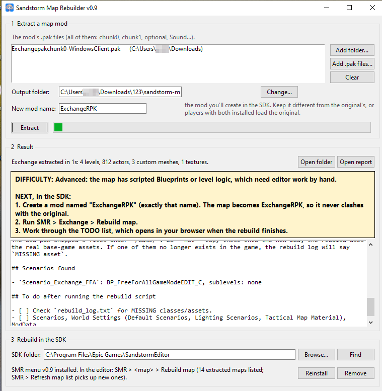
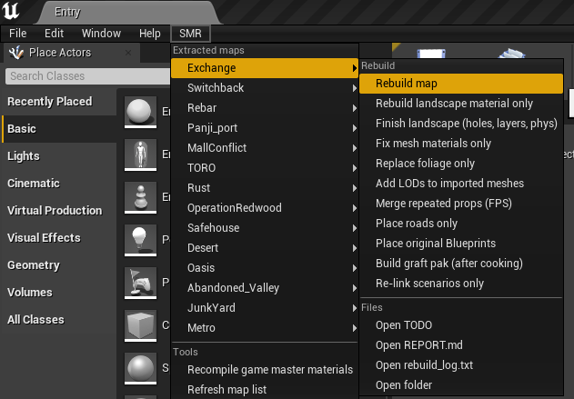
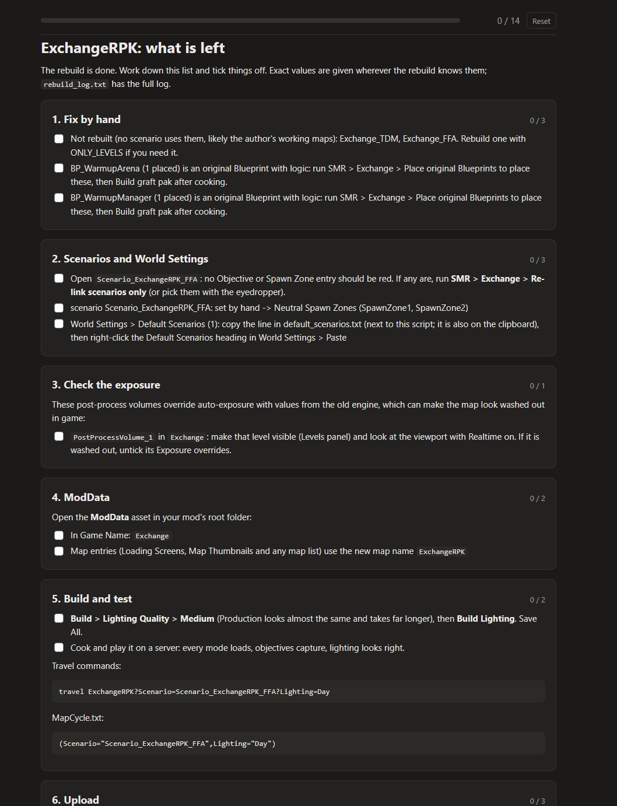

# User guide

This guide walks through rebuilding a map from start to finish. It assumes you know your way around the Sandstorm SDK, but not this tool.

- [Before you start](#before-you-start)
- [1. Install](#1-install)
- [2. Extract the map](#2-extract-the-map)
- [3. Create the mod in the SDK](#3-create-the-mod-in-the-sdk)
- [4. Rebuild the map](#4-rebuild-the-map)
- [5. Import the landscape](#5-import-the-landscape)
- [6. Optional passes](#6-optional-passes)
- [7. Scenarios and World Settings](#7-scenarios-and-world-settings)
- [8. Original Blueprints](#8-original-blueprints)
- [9. Lighting](#9-lighting)
- [10. Navigation, ModData and cooking](#10-navigation-moddata-and-cooking)
- [11. Uploading and testing](#11-uploading-and-testing)
- [Performance](#performance)
- [Troubleshooting](#troubleshooting)
- [Updating the tool](#updating-the-tool)

## Before you start

You need:

- **Windows** and the **Insurgency: Sandstorm SDK**, installed and able to open the `Insurgency` project.
- **The mod's `.pak` files.** If you're subscribed to the mod, they are in `C:\Users\Public\mod.io\254\mods\<mod id>\`. The mod id is in the mod's mod.io URL.
- **Disk space.** Allow about three times the size of the mod's paks for the extracted files and the rebuilt mod, on top of the SDK itself.

A large map (thousands of actors, several sublevels) takes a few minutes to extract and 10 to 30 minutes to rebuild. Lighting builds take longer than either.

## 1. Install

1. Download `SandstormMapRebuilder-vX.zip` from [Releases](../../../releases/latest) and unzip it. The extracted maps are stored next to the exe, in `SMR Maps\` (in `Documents\SMR Maps\` if the exe's folder is read-only, e.g. Program Files).
2. Run `SandstormMapRebuilder.exe`.
3. In the **SDK** section, click **Find**. If it can't find the SDK, click **Browse...** and select the folder that contains the `Insurgency` folder.
4. Click **Install SMR menu**, then restart the SDK. An **SMR** menu appears in the editor's menu bar.

The install adds two files to the SDK's `Insurgency\Content\Python` folder and one line to `init_unreal.py`. **Remove** in the app takes them out again.

## 2. Extract the map

1. Click **Add folder...** and select the folder containing the mod's paks, or **Add .pak files...** to pick them individually. Include every pak the mod ships: chunk0, chunk1, the optional pak, sound paks.
2. Optionally change the output folder. By default it's `SMR Maps\<map name>` next to the exe (or in Documents, see above).
3. Click **Extract**.

When it finishes, the app shows a summary and opens `REPORT.md`, which lists what was found and anything that couldn't be extracted. The output folder contains:

| File or folder | Contents |
|---|---|
| `layout.json` | Everything the rebuild needs: levels, actors, materials, scenarios. Don't edit it. |
| `REPORT.md` | What was found, and what will need to be done by hand |
| `meshes/` | The mod's own static meshes as FBX |
| `textures/` | The mod's textures |
| `landscape/` | Heightmaps and paint layers for the landscape import |
| `sounds/` | The mod's audio as `.wav` (Wwise events have to be recreated by hand) |

Extracting again into the same folder overwrites it; the app asks first.

## 3. Create the mod in the SDK

Create a new mod in the SDK the same way you would for any map mod. **Name it exactly what the app shows** after extraction: the **New mod name** you set before extracting, by default the original's name plus `RPK` (JunkYard becomes JunkYardRPK). The rebuild places every asset under that mod's content folder.

The map and its scenarios are renamed along with the mod, so the travel command changes too: `JunkYard?Scenario=Scenario_JunkYard_Checkpoint_Security` becomes `JunkYardRPK?Scenario=Scenario_JunkYardRPK_Checkpoint_Security`. `TODO.md` lists the new commands.

Why a new name: the game finds mods, maps and scenarios by name. If your rebuild uses the original's name, a player who still has the original subscribed gets whichever one the game finds first. That's usually the old one, which no longer loads on the current game and fails with *Corrupt data found, please verify your installation*. Reinstalling your mod doesn't help them. With a different name, both can be installed side by side.

You can still type the original name in the app, but there's no reason to: grafted Blueprints (step 8) work under the new name too.

If the SDK was open while you extracted, use **SMR > Refresh map list** so the new map appears in the menu.

## 4. Rebuild the map

Run **SMR > *map* > Rebuild map**.

It imports the textures, builds the materials, imports the meshes, creates settings-only Blueprints, then creates every level and places its actors. A progress bar shows each stage. When it finishes, a dialog gives a summary and the TODO list opens in your browser (`TODO.html`; the same list is in `TODO.md`). Its checkboxes are remembered in that browser, and the bar at the top shows how much is left.

**`TODO.md` is the checklist for everything that follows.** It's written for this specific map, in order, with exact values (import settings, scenario text, actors it couldn't place and where they belong). Work down it.

Notes:

- While actors are being placed, the editor keeps running between batches, so it stays responsive. Don't open another map or edit anything until the summary dialog appears.
- If the editor crashes partway (for example out of memory), run **Rebuild map** again: finished levels are skipped and a level in progress resumes from its last save.
- The rebuild is safe to run again. It removes the actors it placed last time and leaves assets you've already made or edited alone.
- "Unable to Check Out From Source Control" dialogs are harmless; the files are saved anyway. Disable source control in the editor toolbar to stop them.
- `rebuild_log.txt` (in the map's folder, or **SMR > *map* > Open rebuild_log.txt**) has the full log of the last run.

## 5. Import the landscape

Landscapes can't be created from Python, so this is manual. `TODO.md` gives, for each landscape:

- the level to import it into,
- the heightmap file in `landscape/`,
- the **Location** to type into the import panel (the landscape's center),
- the **Scale**, **Section Size**, **Sections Per Component** and **Number of Components**,
- the paint layer names and their weight map files.

Open the level, go to the Landscape tool's **Import** tab, enter those values exactly and import. Then assign the landscape material the rebuild created (its name is in `TODO.md`) and import each paint layer's weight map.

Then run **SMR > *map* > Finish landscape (holes, layers, phys)**. The import panel has no field for any of the following, and all three are easy to miss because nothing looks broken in the viewport until you walk the map:

- **The holes.** Stairwells, trenches, cellars and culverts are cut out of the original terrain with its visibility mask, which the extractor saves as `landscape/*_Layer_DataLayer.png`. Without it the landscape is solid and fills every one of them in, sealing cover entrances and making anything underground unreachable.
- **Layer Info.** A paint layer whose **Layer Info** field is empty holds no weight data at all, so a layered terrain material resolves to near-black however good the layer PNGs are.
- **Default Phys Material.** Footstep sounds, bullet impacts and decals all come off this. A hand-imported landscape has it empty, so the whole map sounds and reacts like the engine default.

Because visibility takes the collision away along with the terrain, run **Build > Build Paths** afterwards — navigation still treats the cut areas as solid ground until you do.

If that pass can't do something (the Landscape actor isn't imported yet, or the engine won't take the layer from Python), it says so and `TODO.md` gets the manual steps. To cut a hole by hand, the **Visibility** tool is under **Landscape mode > Sculpt**, not Paint, and the mask PNG shows where to paint: white is cut away.

If a layer or the landscape material needs redoing later, run **SMR > *map* > Rebuild landscape material only**.

Landscape grass only appears after **Build > Build Grass Maps**, and with Foliage scalability above Low.

## 6. Optional passes

These can be run in any order, and again later:

| Entry | When to use it |
|---|---|
| **Replace foliage only** | The map had painted foliage. The first rebuild places foliage as individual actors and caps it per level; this pass places every instance as instanced meshes. It needs a Blueprint you create once (see below). |
| **Place roads only** | The original had roads, curbs or fences made with landscape splines. They're placed as spline mesh actors. |
| **Add LODs to imported meshes** | Always worth running on large maps. The extracted meshes only have full detail. |
| **Merge repeated props (FPS)** | Maps with thousands of props. Meshes placed three or more times in a level become one instanced component. |
| **Fix mesh materials only** | Imported meshes show the default checkered material instead of their own. |
| **Finish landscape (holes, layers, phys)** | After importing a landscape by hand, or any time you re-import one. Safe to run again. |

**The foliage Blueprint.** Python in UE 4.27 can't add components to a Blueprint, so create it once by hand: in the Content Browser, **Add > Blueprint Class > Actor**, name it `BP_SMR_Instances`, open it, **Add Component > Hierarchical Instanced Static Mesh**, compile and save. Any folder works; the rebuild copies it into the mod.

After Merge or Roads, rebuild lighting and paths (steps 9 and 10).

## 7. Scenarios and World Settings

1. Run **SMR > *map* > Re-link scenarios only**. It points the scenarios and World Settings at the objectives and spawn zones as they now exist in the levels.
2. Open the persistent level's **World Settings** and paste the text from `default_scenarios.txt` (it is also copied to the clipboard) into **Default Scenarios**. This one field can't be set from Python. If the mod has several maps, each gets its own `default_scenarios_<map>.txt`; paste each into that map's World Settings (only the main map's line goes on the clipboard).

`TODO.md` lists each scenario with its travel command for testing.

## 8. Original Blueprints

Skip this step if `TODO.md` doesn't list Blueprints with logic.

Blueprint graphs can't be rebuilt from cooked files, and UE 4.27's editor Python has no way to create graph nodes. If the original mod's scripted Blueprints sit at the same paths as your rebuilt mod, the original compiled files can be shipped alongside your build. The tool calls this the graft.

The compiled files have the original's paths written inside them (`/TORO/...`). When the mod is renamed, **Build graft pak** rewrites those paths to the new mod's (`/TORORPK/...`), along with renamed level names, in copies of the files. Nothing else in them changes.

The extractor already kept the original files these Blueprints need in `SMR Maps\<map>\graft`: the Blueprints themselves and everything they use, including files the original mod shipped under `/Game/`. Nothing has to be exported by hand.

A level Blueprint is stored inside its level, so it can't be shipped on its own. When a streamed sublevel has a level Blueprint with logic, the graft pak ships that original sublevel in place of the rebuilt one. Edits you make to that sublevel in the editor won't be in the game, and its static meshes may not match your lighting build. A persistent level is never replaced; its level Blueprint has to be rebuilt by hand.

**Place and fix the placeholders**

1. Run **SMR > *map* > Place original Blueprints**. It creates an empty Blueprint at each original path and places all of their actors in a `Graft` folder in each level.
2. Open `TODO.md`. For each placeholder it lists what's needed so the placed actors keep their positions and settings when the original replaces it:
   - **Root component.** Add a component of the listed type with the listed name (for example a Box Collision named `Null`), then drag it onto `DefaultSceneRoot` to make it the root. `DefaultSceneRoot` itself can't be renamed.
   - **Variables.** Add each listed variable with the listed type and tick **Instance Editable**. These carry per-actor settings such as which button opens which door.
   - Leave the graphs empty. They are never used.
3. Compile and save each placeholder, then run **Place original Blueprints** again. When the placeholders are right, `TODO.md` only lists the graft pak step.

**Build the graft pak** after cooking (step 10).

## 9. Lighting

Maps with day and night versions use lighting scenarios, which are separate sublevels. The editor shows both at once, but only one loads in game.

1. Each scenario level must be flagged as a **Lighting Scenario** (the rebuild does this; if TODO.html lists it, right-click the level in the **Levels** window and make it a Lighting Scenario). Without the flag, every scenario shows whichever one was built last.
2. In the **Levels** window, hide every lighting scenario level except one.
3. Run **Build > Build Lighting Only**. When it asks about hidden levels, answer **Yes**, not *Yes All*, so the hidden scenario keeps its own lighting.
4. Repeat for each scenario.

**Medium** quality is considerably faster than Production and looks almost the same. Rebuild lighting after any change to static meshes (merging, roads, LODs, placeholders).

## 10. Navigation, ModData and cooking

1. **Build > Build Paths.** Repeat after any change to collision, roads or merged props.
2. Fill in the mod's **ModData**: map name, loading screen, thumbnail.
3. Cook the mod as usual.
4. **If you used step 8:** run **SMR > *map* > Build graft pak** after every cook. It writes `<Mod>pakchunk1-WindowsClient_P.pak` next to the cooked paks, so the upload includes it. Cooking rewrites that folder, so the graft pak has to be rebuilt each time.

## 11. Uploading and testing

Upload the mod as usual. Then:

1. **Wait for mod.io.** Each upload is processed before it becomes available. The mod's **Files** page shows a clock icon until it's done. Servers and players get the previous version until then.
2. **Start the server once and leave it running.** The server log shows `ModEvent: BeginInstall` (or `BeginUpdate`) for the mod, then `Installed` once the download finishes. For a large map that takes a few minutes. The map is mounted at that point; no further restart is needed.
3. **Don't restart before `Installed`.** A restart throws away the partial download and starts again.
4. Travel to the map with `AdminTravelMap <Map>?Scenario=<Scenario>`.

On a Linux server, `du -sh <server>/mod.io/common/254/mods/<mod id>` shows whether the download is progressing.

mod.io dedicated servers load mods from the server account's subscriptions, not `Mods.txt`. A hidden mod is only visible to its team; if the server account isn't the uploader, add it as a team member.

## Performance

The rebuild places what the original author placed, so a map runs about as well as the original did. If it runs poorly:

1. **Check the directional light first.** A large *Dynamic Shadow Distance StationaryLight* or a high *Dynamic Shadow Cascades* count is the most common cause of low frame rates. Keep the original's values; 2 cascades is usually enough.
2. Run **Add LODs to imported meshes**.
3. Run **Merge repeated props (FPS)** on prop-heavy maps.
4. Judge performance in game, or in the editor with only one lighting scenario visible. With both visible, the editor renders two suns.

`stat unit` shows frame, game, draw and GPU time in game. In the editor, **Ctrl+Shift+,** opens the GPU Visualizer, which breaks GPU time down by pass.

## Troubleshooting

| Symptom | Cause | Fix |
|---|---|---|
| New menu entries missing, or a fix doesn't take effect | The SDK still has the previous menu and script installed | In the app, click **Update SMR menu**, then restart the SDK |
| The map isn't in the SMR menu | The SDK was open during extraction | **SMR > Refresh map list** |
| Meshes show the checkered default material | Material slots weren't linked | **Fix mesh materials only** |
| Game materials show plain gray | The game's master materials need recompiling after a texture change | **SMR > Recompile game master materials** |
| The mod's custom materials (stand-ins) render plain grey although their textures are set | The stand-in parent material was made by an older version and doesn't compile | Update the SMR menu, then **Fix mesh materials only** |
| Only some foliage appears | The first rebuild caps foliage actors per level | **Replace foliage only** |
| Roads are missing, or props float above the street | Landscape spline meshes weren't placed | **Place roads only** |
| The game freezes when bots spawn, or a scenario never finishes loading | A partial TacticalGrid makes bot pathfinding search the whole map. The rebuild doesn't place one. | If you placed or kept a TacticalGrid, delete it. Bots work without it. |
| Water renders as gray ground, or rock faces are see-through, after merging | Merged with an earlier version of the merge | Run **Merge repeated props** again; it splits those back out |
| Shadows change abruptly a short distance from the player | Lighting isn't built for the current geometry, or the live shadow range doesn't match what was baked | Rebuild lighting for each scenario (step 9) |
| The terrain is near-black, however the layer PNGs look | A paint layer has no **Layer Info** assigned, so it holds no weight data | **Finish landscape (holes, layers, phys)**, or assign each `<layer>_LayerInfo` by hand in **Landscape mode > Paint** |
| Stairwells, trenches and cellars are filled in with dirt; underground areas are unreachable | The original's visibility mask wasn't applied, so the landscape is solid | **Finish landscape (holes, layers, phys)**, then **Build > Build Paths** |
| Footsteps and bullet impacts on the ground use the wrong surface | The hand-imported landscape has no **Default Phys Material** | **Finish landscape (holes, layers, phys)** |
| You fall through buildings, floors or concrete; only the terrain holds you up | Those meshes are set to a collision complexity that needs simple collision, but their convex hulls didn't survive the FBX import | Rebuild the map, or the meshes, with the current version: it detects a missing hull and switches that mesh to **Use Complex Collision As Simple** |
| Meshes render near-black under any light, while the albedo is right in Unlit | Vertex normals came in wrong (extracts before r39 decoded them incorrectly) | Extract the map again with the current version and run **Rebuild map**: the meshes re-import with their original normals. Check with **Buffer Visualization > World Normal**: an upward face should read lavender, not pink |
| Low frame rate | See [Performance](#performance) | |
| Animated actors stand in a T-pose, or shots pass through them | The graft pak is missing files the original Blueprints use (for example a skeleton the original shipped under `/Game/`) | Extract the map again with the current version, run **Build graft pak**, and check the log line listing the `/Game/` files it included |
| Server log shows `class mismatch BlueprintGeneratedClass != DynamicClass`; grafted actors can't detect players or spawn projectiles | The original was cooked when the game's Blueprints were nativized | Extract the map again with the current version and rebuild the graft pak; the extractor rewrites those references |
| The editor crashes with "Ran out of memory" during **Rebuild map** on a big map | Placing thousands of actors in one go | Restart the editor and run **Rebuild map** again. Finished levels are skipped and a level in progress resumes from its last save (every 1000 actors). `rebuild_log.txt` records the editor's memory at each save |
| Grafted actors are at the world origin | The placeholder's root component doesn't match the original | Fix the root as `TODO.md` says, run **Place original Blueprints** again, cook, rebuild the graft pak |
| The server keeps the old version | mod.io hasn't finished processing, or the server was restarted mid-download | See [step 11](#11-uploading-and-testing) |
| "An upload session with that idempotency key has already been completed" | mod.io considers the upload identical to an earlier one | Cook again, rebuild the graft pak if used, and upload |
| "Unable to Check Out From Source Control" | Source control is enabled in the editor | Harmless; disable source control to stop the dialogs |

If something isn't covered here, `rebuild_log.txt` and the editor's Output Log usually say what failed.

## Extra scripts

Two scripts for problems outside a normal rebuild. They are in the `extras` folder of the download (and `sdk/` in the source). Set the name(s) at the top of the script, then run it with **File > Execute Python Script...** in the SDK.

| Script | When to use it |
|---|---|
| `smr_localize_deps.py` | The map looks right in the editor, but some materials or meshes render black or grey in the cooked game. The SDK has every mod mounted at once, so a mod can end up using another mod's assets without anyone noticing, and players without that other mod don't have them. It points meshes, material instances and foliage/grass types at copies inside your mod. A level that uses another mod's asset directly (an actor's mesh, a landscape's layer infos) is not changed: it is listed in the Output Log as `BY HAND` with what it uses, so you can move or re-pick those assets yourself. Set `MOD` to your mod's name and cook again afterwards. |
| `smr_rename_mod.py` | A map was rebuilt under the original mod's name and should get its own (players with the original subscribed load the original instead). Create an empty mod with the new name, set `OLD` and `NEW`, and run it: everything moves across with your landscape, lighting and fixes; nothing is rebuilt. |

## Updating the tool

1. Download the new release and unzip it over the old folder (your extracted maps in `SMR Maps\` are kept).
2. Run the app and click **Update SMR menu**, then restart the SDK.

Maps extracted with an older version keep working. If a release note says the extractor changed (for example, it now extracts something new), extract the map again to get it.
